# 1. Conception et implémentation de la transmission classique

## 1.1. Présentation générale

La première approche consiste à transmettre une image à l'aide d'une chaîne de communication numérique classique. La compression de l'image et la protection contre les erreurs sont réalisées par des composants distincts.

La compression JPEG réduit la quantité de données à transmettre. Un code correcteur Hamming (7,4) ajoute ensuite de la redondance pour corriger certaines erreurs introduites par le canal. Les bits sont transmis à l'aide d'une modulation QPSK sur un canal AWGN.

L'objectif est d'étudier l'influence du bruit et du codage correcteur sur la récupération du fichier JPEG et sur la qualité de l'image reconstruite. Cette approche ne nécessite aucun entraînement.

## 1.2. Architecture de la chaîne de transmission

```text
Émetteur : image RGB → compression JPEG → bits → Hamming (7,4) → QPSK
                                                                 ↓
                                                            Canal AWGN
                                                                 ↓
Récepteur : image reconstruite ← JPEG ← octets ← Hamming ← démodulation QPSK
```

Une deuxième configuration désactive le codage et le décodage Hamming pour comparer la transmission avec et sans correction d'erreurs.

### 1.2.1. Compression JPEG

L'image est convertie en RGB et redimensionnée à 128 × 128 pixels, puis compressée au format JPEG avec une qualité de 75. Les octets du fichier sont convertis en une suite de bits.

JPEG est une compression avec pertes : même si tous les bits sont correctement reçus, l'image obtenue peut différer de l'image originale. Le paramètre de qualité règle le compromis entre la taille du fichier et la fidélité visuelle.

### 1.2.2. Codage correcteur Hamming (7,4)

Le code Hamming transforme chaque bloc de 4 bits d'information en un bloc de 7 bits. Les 3 bits supplémentaires permettent de corriger une erreur par bloc de 7 bits.

Cette protection, appelée FEC (*Forward Error Correction*), augmente le nombre de bits transmis de 75 %, hors éventuel remplissage. Plusieurs erreurs dans un même bloc peuvent dépasser la capacité de correction et conduire à un décodage incorrect.

L'encodeur et le décodeur Hamming sont implémentés dans `src/classical/hamming74.py`.

### 1.2.3. Modulation QPSK et canal AWGN

La modulation QPSK (*Quadrature Phase Shift Keying*) associe chaque paire de bits à un symbole complexe parmi quatre possibilités, avec un étiquetage de Gray. Les symboles traversent le canal AWGN, qui ajoute un bruit gaussien.

Le récepteur choisit le point de constellation le plus proche pour retrouver les bits. Lorsque le SNR diminue, le bruit augmente et les décisions deviennent moins fiables. Le canal est défini dans `src/channels/awgn.py`.

### 1.2.4. Reconstruction de l'image

Après démodulation et, si activé, décodage Hamming, les bits sont regroupés en octets pour reconstituer le fichier JPEG.

Si des erreurs subsistent, l'image peut être déformée ou le fichier peut devenir illisible. Les métriques de qualité d'image sont calculées uniquement lorsque le JPEG reçu peut être décodé.

La chaîne complète est implémentée dans `src/classical/pipeline.py`.

## 1.3. Protocole expérimental

Les paramètres par défaut de l'expérience sont les suivants :

| Paramètre | Valeur |
|---|---|
| Image d'entrée | `data/input.jpg` |
| Résolution | 128 × 128, RGB |
| Compression | JPEG, qualité 75 |
| Codage correcteur | Sans FEC ou Hamming (7,4) |
| Modulation | QPSK |
| Canal | AWGN complexe |
| SNR évalués | 5, 8, 10 et 12 dB |
| Dossier de sortie | `results/classical/fec/` |

Depuis la racine du projet, avec l'environnement Python et les dépendances installés, l'expérience se lance avec :

```bash
python -m scripts.classical.demo_metrics
```

Le programme enregistre l'image de référence, les JPEG reçus, les reconstructions décodables et le fichier `metriques.csv`. Une nouvelle exécution remplace les sorties portant les mêmes noms. Dans les noms de fichiers, `avec_fec` et `sans_fec` désignent les configurations avec et sans correction d'erreurs.

## 1.4. Métriques d'évaluation

Trois informations permettent d'évaluer la transmission :

- **BER (*Bit Error Rate*)** : proportion de bits erronés parmi les bits récupérés. Une valeur faible indique une meilleure récupération des données.
- **Lisibilité JPEG** : indique si le fichier reçu peut être ouvert. Un BER faible ne garantit pas à lui seul un fichier exploitable.
- **PSNR et SSIM** : mesurent la qualité de l'image reconstruite par rapport à l'image de référence avant compression. Des valeurs élevées indiquent une meilleure reconstruction.

Le calcul des métriques d'image est défini dans `src/metrics/image_quality.py`.

## 1.5. Résultats expérimentaux et discussion

### 1.5.1. Influence du codage correcteur sur les erreurs de transmission

Les mesures suivantes proviennent du fichier [metriques.csv](results/classical/fec/metriques.csv). Elles décrivent l'expérience sauvegardée ; les réalisations du bruit peuvent produire des résultats différents lors d'une autre exécution.

| SNR | BER sans FEC | BER avec FEC | JPEG sans FEC lisible | JPEG avec FEC lisible |
|---|---|---|---|---|
| 5 dB | 0,03765 | 0,01202 | Non | Non |
| 8 dB | 0,00587 | 0,000174 | Non | Non |
| 10 dB | 0,00118 | 0 | Non | Oui |
| 12 dB | 0,0000347 | 0 | Oui | Oui |

À 8 dB, le codage réduit fortement le BER, mais les erreurs restantes empêchent encore la lecture du JPEG. À 10 et 12 dB, la configuration avec FEC récupère tous les bits du fichier et atteint un PSNR de 32,81 dB et un SSIM de 0,923. L'écart restant avec l'image originale provient de la compression JPEG.

À 12 dB sans FEC, le fichier est lisible malgré une erreur résiduelle, mais sa qualité est dégradée : le PSNR est de 15,40 dB et le SSIM de 0,826. Cet exemple montre que la position d'une erreur dans le fichier peut avoir un effet important sur l'image.


Ces résultats illustrent l'effet de seuil de la transmission de fichiers compressés : une augmentation du bruit peut rendre le JPEG inexploitable. Le gain obtenu avec Hamming s'accompagne d'un nombre plus élevé de symboles transmis ; cette expérience compare les configurations à SNR identique, sans imposer un budget de transmission identique.

### 1.5.2. Résultats visuels et qualité de reconstruction sur l'image de test

Une expérience supplémentaire a été sauvegardée le 14 novembre 2026 sur `data/test_images/test.png`, en résolution 128 × 128, avec une qualité JPEG de 75 et une graine aléatoire de 42. Ses [paramètres](results/classical/picture_tests/test_20261114_151430_101219/run.json) et ses [mesures complètes](results/classical/picture_tests/test_20261114_151430_101219/metriques.csv) sont conservés dans un dossier distinct. Les valeurs ci-dessous appartiennent à cette expérience et ne remplacent pas celles du tableau précédent.

| SNR | Configuration | Bits erronés | BER | JPEG lisible | PSNR | SSIM |
|---|---|---|---|---|---|---|
| 5 dB | Sans FEC | 1 388 | 0,03743 | Non | — | — |
| 5 dB | Avec FEC | 415 | 0,01119 | Non | — | — |
| 8 dB | Sans FEC | 234 | 0,00631 | Non | — | — |
| 8 dB | Avec FEC | 13 | 0,000351 | Oui | 10,90 dB | 0,312 |
| 10 dB | Sans FEC | 27 | 0,000728 | Oui | 10,36 dB | 0,276 |
| 10 dB | Avec FEC | 0 | 0 | Oui | 31,98 dB | 0,942 |
| 12 dB | Sans FEC | 0 | 0 | Oui | 31,98 dB | 0,942 |
| 12 dB | Avec FEC | 0 | 0 | Oui | 31,98 dB | 0,942 |

Le symbole « — » indique que le JPEG n'a pas pu être décodé : aucune valeur de PSNR ou de SSIM n'est disponible pour cette transmission.

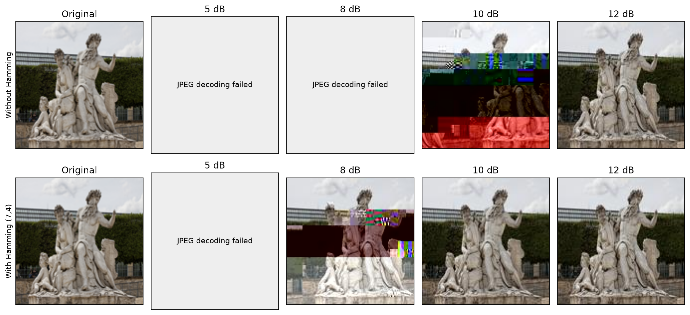

À 5 dB, les deux configurations échouent à produire un JPEG lisible. À 8 dB, Hamming permet de récupérer un fichier décodable, mais les 13 erreurs restantes s'accompagnent d'une qualité faible. À 10 dB, il corrige toutes les erreurs de cette transmission, tandis que la configuration sans FEC conserve une forte dégradation. À 12 dB, les deux configurations récupèrent le JPEG sans erreur et atteignent la même qualité.

Ces résultats distinguent deux critères : **pouvoir ouvrir le fichier** et **obtenir une image fidèle**. Un JPEG lisible peut encore présenter une qualité de reconstruction très faible.

## 1.6. Conclusion

La transmission classique constitue une référence fondée sur des composants explicites : JPEG pour la compression, Hamming pour la protection et QPSK pour la modulation. Le codage correcteur améliore la récupération des bits, mais sa capacité reste limitée lorsque le bruit est élevé.

Cette approche met en évidence l'importance de la récupération du fichier compressé : quelques erreurs peuvent suffire à empêcher sa lecture ou à dégrader fortement l'image.

# 2. Conception et implémentation du JSCC syntaxique

## 2.1. Présentation générale

La deuxième approche repose sur le JSCC (*Joint Source-Channel Coding*), ou codage conjoint source-canal. Elle apprend une représentation de l'image qui combine compression et résistance au bruit.

Dans ce projet, le JSCC syntaxique est implémenté par un réseau neuronal de type DeepJSCC. Le terme « syntaxique » désigne ici un objectif de reconstruction des pixels, optimisé avec la MSE. La partie 3 présente séparément le système sémantique et l'étude de la perte perceptuelle.

Contrairement à la chaîne classique, ce modèle ne produit pas de fichier JPEG intermédiaire et n'utilise ni code Hamming ni modulation QPSK explicite. L'encodeur génère directement les valeurs destinées à la transmission.

```text
Image RGB → encodeur CNN → normalisation → canal AWGN → décodeur CNN → image reconstruite
```

Le modèle complet, nommé `SyntaxicJSCC`, est défini dans `src/jscc/model.py`.

## 2.2. Architecture du système proposé

### 2.2.1. Encodeur neuronal

L'encodeur transforme une image de dimension 3 × 128 × 128 en un tenseur latent de dimension 16 × 16 × 16. Il utilise trois convolutions de noyau 5 × 5 et de stride 2 :

| Couche | Canaux | Résolution de sortie | Activation |
|---|---|---|---|
| Convolution 1 | 3 → 32 | 64 × 64 | PReLU |
| Convolution 2 | 32 → 64 | 32 × 32 | PReLU |
| Convolution 3 | 64 → 16 | 16 × 16 | Aucune |

La représentation contient 4 096 valeurs réelles par image. L'architecture est implémentée dans `src/jscc/encoder.py`.

### 2.2.2. Symboles complexes et normalisation de puissance

Les valeurs latentes sont regroupées par paires, chaque paire formant les parties réelle et imaginaire d'un symbole complexe. Une image est ainsi représentée par **2 048 symboles complexes**.

La puissance moyenne est normalisée à environ 1 pour chaque image :

$$
\tilde{z}_k = \frac{z_k}{\sqrt{\frac{1}{K}\sum_{j=1}^{K}|z_j|^2 + \varepsilon}}, \qquad K = 2048
$$

Cette étape impose une contrainte de puissance au signal transmis. Elle est définie dans `src/jscc/normalization.py`.

### 2.2.3. Canal AWGN et décodeur neuronal

Le canal ajoute un bruit gaussien aux symboles normalisés. Le décodeur sépare ensuite leurs composantes réelle et imaginaire pour retrouver un tenseur de dimension 16 × 16 × 16.

Trois convolutions transposées de noyau 4 × 4 et de stride 2 reconstruisent progressivement l'image :

| Couche | Canaux | Résolution de sortie | Activation |
|---|---|---|---|
| Convolution transposée 1 | 16 → 64 | 32 × 32 | PReLU |
| Convolution transposée 2 | 64 → 32 | 64 × 64 | PReLU |
| Convolution transposée 3 | 32 → 3 | 128 × 128 | Sigmoid |

La fonction Sigmoid maintient les pixels reconstruits entre 0 et 1. Le décodeur est implémenté dans `src/jscc/decoder.py`.

## 2.3. Fonction de perte et entraînement

L'encodeur et le décodeur sont entraînés conjointement à travers le canal bruité. La fonction objectif est l'erreur quadratique moyenne entre l'image originale et sa reconstruction :

$$
\mathcal{L}_{\mathrm{MSE}} = \frac{1}{N}\sum_{i=1}^{N}(x_i-\hat{x}_i)^2
$$

L'optimiseur Adam ajuste les poids pour réduire cette erreur. Le bruit est présent pendant l'entraînement, ce qui permet au modèle d'apprendre une représentation adaptée aux perturbations du canal.

Les paramètres définis dans `src/jscc/training.py` sont les suivants :

| Paramètre | Valeur |
|---|---|
| Images d'entraînement | `data/train_images/` |
| Résolution d'entrée | 128 × 128, RGB |
| Normalisation des pixels | Entre 0 et 1 |
| Répartition entraînement / validation | 80 % / 20 %, avec arrondi du nombre d'images d'entraînement |
| Taille du batch | 4 |
| Nombre d'époques | 10 |
| Optimiseur | Adam |
| Taux d'apprentissage | 0,001 |
| Fonction de perte | MSE |
| SNR pendant l'entraînement | 10 dB, fixe |
| Graine aléatoire | 42 |
| Périphérique configuré | CPU |

Le chargement des images JPG, JPEG et PNG est réalisé dans `src/jscc/dataset.py`. Ce pipeline utilise les images de son dossier d'entraînement ; le protocole CIFAR-10 de la partie 3 est distinct.

Le meilleur modèle selon la perte de validation est enregistré dans `results/jscc/best_model.pth`, et les pertes par époque dans `results/jscc/history.csv`.

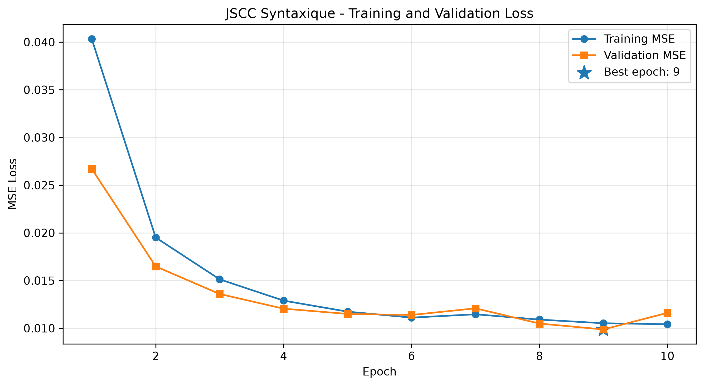

## 2.4. Protocole d'évaluation

L'inférence charge les poids entraînés et reconstruit une image sans modifier ces poids. L'évaluation sur une seule image utilise par défaut `data/test_images/test.png` et les SNR suivants : **0, 5, 10, 15 et 20 dB**.

Le script `src/jscc/inference.py` sauvegarde l'image de référence, les reconstructions et `metrics.csv` dans `results/jscc/evaluation/`.

Une évaluation complémentaire, définie dans `src/jscc/evaluation.py`, parcourt `data/test_images/` et réalise cinq transmissions bruitées par image et par SNR. Elle sauvegarde les mesures détaillées et leur synthèse dans `results/jscc/evaluation_multi/`.

Le fichier de synthèse actuellement sauvegardé contient une seule image. Ses écarts-types entre images sont donc nuls par construction ; ils ne démontrent pas une absence de variation due au bruit.

## 2.5. Métriques et résultats expérimentaux

Le **PSNR** évalue la fidélité de reconstruction à partir de l'erreur quadratique. Le **SSIM** mesure la similarité structurelle des images. Pour les deux métriques, une valeur plus élevée indique une meilleure reconstruction.

### 2.5.1. Évolution du PSNR et du SSIM avec le SNR

Les résultats suivants proviennent de [l'évaluation sur une image](results/jscc/evaluation/metrics.csv) :

| SNR du canal | PSNR | SSIM |
|---|---|---|
| 0 dB | 18,52 dB | 0,453 |
| 5 dB | 20,31 dB | 0,539 |
| 10 dB | 20,90 dB | 0,586 |
| 15 dB | 21,21 dB | 0,602 |
| 20 dB | 21,27 dB | 0,608 |

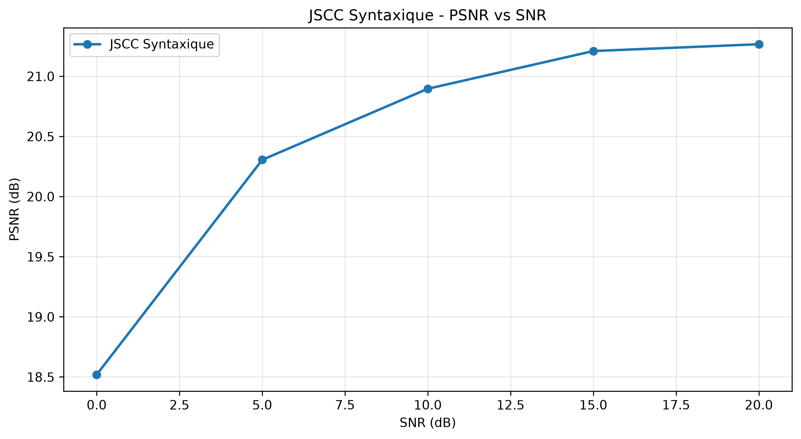

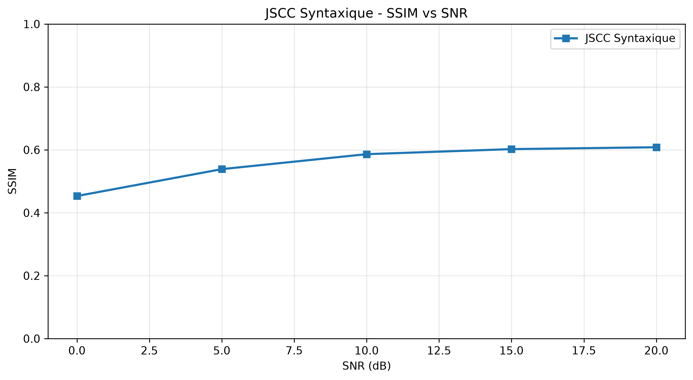

La qualité augmente avec le SNR, puis progresse plus faiblement entre 15 et 20 dB. Cette tendance est compatible avec une limitation liée à la représentation et au modèle, en plus de l'effet du bruit.

Le décodeur produit directement une image à partir des symboles reçus, sans devoir ouvrir un fichier JPEG. Une augmentation du bruit se traduit généralement par une perte progressive de détails ou une image plus floue.

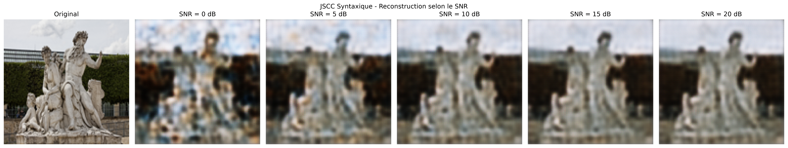

Ces mesures caractérisent les images et le modèle évalués. Elles ne suffisent pas à établir une supériorité générale sur l'approche classique : une comparaison directe doit conserver les mêmes images, le même canal, la même puissance et le même nombre de symboles transmis, en tenant compte de la redondance Hamming.

### 2.5.2. Comparaison visuelle sur l'image de test

L'expérience sauvegardée le 14 novembre 2026 utilise `data/test_images/test.png`, en résolution 128 × 128, avec la graine 42 et le modèle `results/jscc/best_model.pth`. Ses [paramètres](results/jscc/picture_tests/test_20261114_151121_458269/run.json) et ses [métriques](results/jscc/picture_tests/test_20261114_151121_458269/metrics.csv) sont disponibles avec les reconstructions. Les valeurs sauvegardées correspondent à celles du tableau de la section 2.5.1.

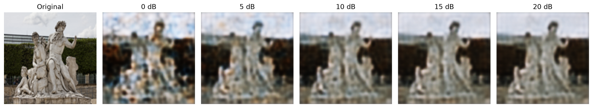

Entre 0 et 20 dB, le PSNR passe de 18,52 à 21,27 dB, soit un gain de 2,75 dB. Le SSIM passe de 0,453 à 0,608. Le modèle fournit une reconstruction pour chaque SNR testé, y compris à 0 dB, avec une fidélité plus faible lorsque le bruit est important.

Le gain devient plus limité entre 15 et 20 dB : environ 0,06 dB de PSNR. Une amélioration du canal ne suffit donc pas à éliminer toutes les erreurs de reconstruction de ce modèle.

### 2.5.3. Résultats avec répétitions du bruit

Le fichier [summary.csv](results/jscc/evaluation_multi/summary.csv) contient les résultats moyens obtenus sur une image avec cinq réalisations du bruit par SNR :

| SNR | Nombre d'images | Répétitions par image | PSNR moyen | SSIM moyen |
|---|---|---|---|---|
| 0 dB | 1 | 5 | 18,54 dB | 0,453 |
| 5 dB | 1 | 5 | 20,24 dB | 0,537 |
| 10 dB | 1 | 5 | 20,98 dB | 0,586 |
| 15 dB | 1 | 5 | 21,19 dB | 0,602 |
| 20 dB | 1 | 5 | 21,26 dB | 0,608 |

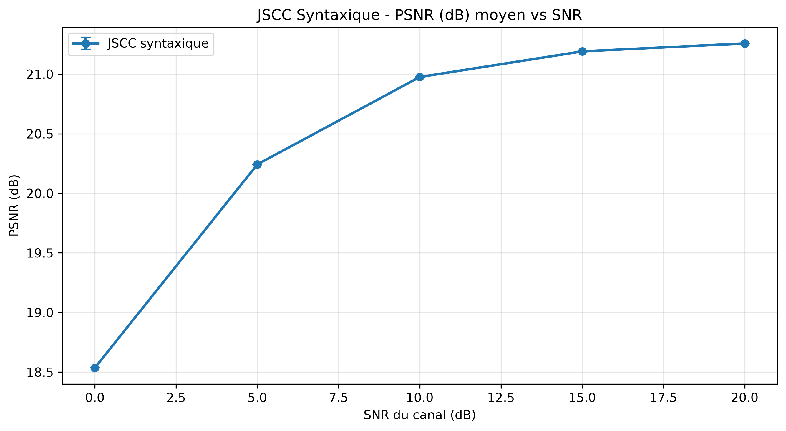

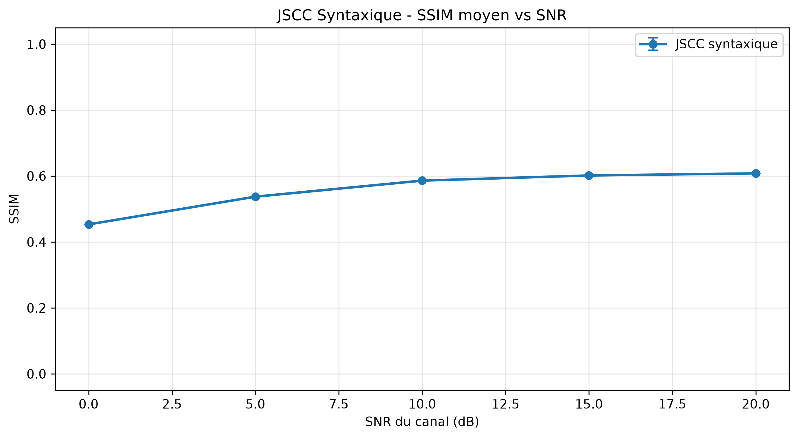

La tendance reste proche de celle de l'évaluation précédente : la qualité augmente avec le SNR, puis tend à se stabiliser. Ces répétitions caractérisent plusieurs transmissions d'une même image ; une évaluation sur davantage d'images reste nécessaire pour étudier la généralisation. Les transmissions individuelles sont disponibles dans [details.csv](results/jscc/evaluation_multi/details.csv).

## 2.6. Exécution des expériences

Depuis la racine du projet, avec l'environnement Python et les dépendances installés :

```bash
# Entraînement de l'encodeur et du décodeur
python -m scripts.jscc.train_jscc

# Reconstruction d'une image avec le modèle sauvegardé
python -m scripts.jscc.evaluate_jscc

# Évaluation des images du dossier de test avec répétitions du bruit
python -m scripts.jscc.evaluate_jscc_multi

# Génération des graphiques d'entraînement et d'évaluation
python -m scripts.jscc.plot_jscc
```

L'entraînement nécessite au moins cinq images pour constituer les ensembles d'entraînement et de validation. Une nouvelle exécution peut remplacer le modèle, les métriques et les figures déjà présents aux chemins de sortie.

## 2.7. Conclusion

Le JSCC syntaxique remplace les étapes séparées de compression et de protection par un apprentissage conjoint de bout en bout. L'encodeur transmet une représentation continue de l'image, et le décodeur apprend à reconstruire les pixels malgré le bruit.

Cette approche fournit une référence neuronale optimisée avec la MSE. La partie suivante étudie un système sémantique distinct et l'apport d'une perte perceptuelle à la reconstruction des images.

# 3. Conception et implémentation du système de communication sémantique des images

## 3.1. Présentation générale

Dans cette partie du projet, nous avons développé un système de communication sémantique basé sur le Deep Learning pour la transmission d'images à travers un canal de communication bruité.

Contrairement aux systèmes de transmission classiques qui cherchent à reconstruire les données transmises bit par bit, la communication sémantique vise à préserver les caractéristiques importantes de l'information transmise.

Le système proposé repose sur une architecture de type encodeur-canal-décodeur (Encoder-Channel-Decoder). Il comprend trois composants principaux :

- Un encodeur neuronal chargé d'extraire une représentation compacte de l'image.
- Un canal AWGN simulant les perturbations dues au bruit.
- Un décodeur neuronal chargé de reconstruire l'image à partir de la représentation reçue.

L'objectif est d'étudier la capacité du système à reconstruire des images de bonne qualité pour différents niveaux de bruit.

## 3.2. Architecture du système proposé

### 3.2.1. Encodeur neuronal

L'encodeur est un réseau de neurones convolutif (CNN) qui transforme l'image originale en une représentation latente de dimension réduite.

Il est constitué de trois couches convolutives :

- Première couche : convolution avec 32 filtres, suivie d'une fonction d'activation ReLU et d'un sous-échantillonnage avec un stride de 2.
- Deuxième couche : convolution avec 64 filtres, suivie d'une fonction ReLU et d'un sous-échantillonnage avec un stride de 2.
- Troisième couche : convolution avec 2 filtres, produisant la représentation destinée à la transmission.

L'image d'entrée possède trois canaux de couleur RGB et une résolution de 128 × 128 pixels. Après encodage, elle est représentée par un tenseur de dimension 2 × 32 × 32.

Cette transformation réduit considérablement la dimension de la représentation transmise.
L'encodeur est implémenté dans `src/models/semantic/encoder.py`.

### 3.2.2. Canal de communication AWGN

Afin de simuler les conditions d'un canal de communication réel, nous avons intégré un canal AWGN (Additive White Gaussian Noise).

Ce canal ajoute un bruit gaussien blanc additif au signal transmis.

Le signal reçu est donné par :

$$
y = x + n
$$

où :

- $x$ représente le signal transmis ;
- $n$ représente le bruit gaussien ;
- $y$ représente le signal reçu.

Le niveau de bruit est contrôlé par le rapport signal sur bruit (SNR), exprimé en décibels :

$$
\mathrm{SNR}_{\mathrm{dB}} = 10 \log_{10}\left(\frac{P_{\mathrm{signal}}}{P_{\mathrm{noise}}}\right)
$$

Dans notre implémentation, la représentation latente est normalisée afin que sa puissance moyenne complexe soit égale à 1 pour chaque échantillon.

Le bruit est ensuite généré indépendamment sur les deux composantes du signal (I et Q). Sa variance par composante réelle est définie par :

$$
\sigma^2 = \frac{1}{2 \times \mathrm{SNR}_{\mathrm{linear}}}
$$

avec :

$$
\mathrm{SNR}_{\mathrm{linear}} = 10^{\mathrm{SNR}_{\mathrm{dB}}/10}
$$

Cette approche permet de contrôler précisément les conditions de transmission et de tester la robustesse du système face à différents niveaux de bruit.
La simulation du canal est réalisée dans `src/channels/awgn.py` et testée dans `tests/test_awgn.py`.

### 3.2.3. Décodeur neuronal

Le décodeur est également basé sur un réseau convolutif.

Il reçoit la représentation bruitée provenant du canal AWGN et tente de reconstruire l'image originale.

Son architecture comprend :

- Une couche convolutive transformant les deux canaux reçus en 64 caractéristiques.
- Une première couche de convolution transposée permettant d'augmenter la résolution.
- Une deuxième couche de convolution transposée permettant de retrouver les trois canaux RGB.
- Une fonction d'activation Sigmoid garantissant des valeurs de pixels comprises entre 0 et 1.

Le résultat final est une image reconstruite de dimension 3 × 128 × 128.
Le décodeur est défini dans `src/models/semantic/decoder.py` ; le modèle complet qui relie l'encodeur, le canal et le décodeur se trouve dans `src/models/semantic/semantic_model.py` et est testé dans `tests/test_semantic_model.py`.

## 3.3. Fonctions de perte utilisées

Afin d'étudier l'influence de la fonction objectif sur la qualité des images reconstruites, deux stratégies d'entraînement ont été comparées.

### 3.3.1. Fonction de perte MSE

La première stratégie repose sur l'erreur quadratique moyenne (Mean Squared Error).

Elle mesure la différence pixel par pixel entre l'image originale et l'image reconstruite.

La fonction est définie par :

$$
\mathcal{L}_{\mathrm{MSE}} = \frac{1}{N} \sum_{i=1}^{N} (x_i - \hat{x}_i)^2
$$

où :

- x_i représente un pixel de l'image originale ;
- x̂_i représente le pixel correspondant de l'image reconstruite ;
- N représente le nombre total de valeurs de pixels.

Cette fonction de perte constitue une première référence pour entraîner le système de communication.
La perte perceptuelle décrite ci-dessous est implémentée dans `src/models/semantic/losses.py`.

### 3.3.2. Fonction de perte perceptuelle

Dans la deuxième stratégie, nous avons ajouté une perte perceptuelle basée sur un réseau VGG16 pré-entraîné sur ImageNet.

Contrairement à la MSE, qui compare directement les pixels, la perte perceptuelle compare les caractéristiques extraites des images par le réseau VGG16.

Les couches utilisées sont gelées afin de conserver les caractéristiques apprises pendant le pré-entraînement.

La perte perceptuelle est calculée à partir de la distance L1 entre les représentations extraites de l'image originale et de l'image reconstruite :

$$
\mathcal{L}_{\mathrm{perceptual}} = \left\lVert \phi(x) - \phi(\hat{x}) \right\rVert_1
$$

où $\phi$ représente l'extracteur de caractéristiques VGG16.

La fonction de perte totale utilisée pendant le deuxième entraînement est :

$$
\mathcal{L}_{\mathrm{total}} = \mathcal{L}_{\mathrm{MSE}} + \lambda \times \mathcal{L}_{\mathrm{perceptual}}
$$

Le coefficient $\lambda$ a été fixé à 0,01.

Ce choix permet de combiner la précision de reconstruction pixel par pixel avec la préservation des caractéristiques visuelles.

Les deux stratégies sont comparées afin d'étudier l'apport de la perte perceptuelle dans le contexte de la communication sémantique.

## 3.4. Protocole expérimental

### 3.4.1. Jeu de données

Les expériences ont été réalisées sur le jeu de données CIFAR-10.

Ce jeu de données contient des images appartenant à dix classes différentes. Les images originales possèdent une résolution de 32 × 32 pixels.

Pour les besoins de notre architecture, les images ont été redimensionnées à 128 × 128 pixels et converties en tenseurs.

Un sous-ensemble de 5 000 images a été utilisé pour l'entraînement et 1 000 images pour l'évaluation.
Le chargement, le redimensionnement et la préparation des jeux de données sont effectués dans `src/datasets/image_dataset.py`.

### 3.4.2. Paramètres d'entraînement

Les paramètres utilisés sont les suivants :

| Paramètre | Valeur |
|---|---|
| Architecture | CNN Encoder-Decoder |
| Jeu de données | CIFAR-10 |
| Résolution d'entrée | 128 × 128 |
| Taille du batch | 32 |
| Nombre d'époques | 3 |
| Optimiseur | Adam |
| Taux d'apprentissage | 0,001 |
| Fonction de perte 1 | MSE |
| Fonction de perte 2 | MSE + 0,01 × Perceptual Loss |
| Canal | AWGN |
| SNR pendant l'entraînement | Tiré aléatoirement entre 0 et 20 dB |

Le SNR est choisi aléatoirement pendant l'entraînement afin d'exposer le modèle à différentes conditions de transmission.
Le script d'entraînement est `src/training/train_semantic.py`.

### 3.4.3. Conditions d'évaluation

Les deux modèles entraînés ont été évalués sur les mêmes conditions de transmission.

Les valeurs de SNR considérées sont :

- -5 dB
- 0 dB
- 5 dB
- 10 dB
- 15 dB
- 20 dB

Cette évaluation permet d'observer le comportement du système lorsque le niveau de bruit varie.
L'évaluation des modèles pour ces valeurs de SNR et l'enregistrement des résultats sont effectués par `src/evaluation/evaluate_semantic.py`.

## 3.5. Métriques d'évaluation

Trois métriques ont été utilisées pour comparer les performances des deux modèles.

### 3.5.1. Peak Signal-to-Noise Ratio (PSNR)

Le PSNR mesure la qualité de reconstruction en se basant sur l'erreur quadratique moyenne entre l'image originale et l'image reconstruite.

Une valeur élevée indique une meilleure qualité de reconstruction.
Le calcul du PSNR est défini dans `src/evaluation/metrics.py`.

### 3.5.2. Structural Similarity Index (SSIM)

Le SSIM mesure la similarité structurelle entre deux images en tenant compte de leur luminance, de leur contraste et de leur structure.

Sa valeur est généralement comprise entre 0 et 1. Une valeur proche de 1 indique une forte similarité.
Le calcul du SSIM est également défini dans `src/evaluation/metrics.py`.

### 3.5.3. Perceptual Loss

La Perceptual Loss mesure la différence entre les caractéristiques extraites des images originales et reconstruites à l'aide de VGG16.

Une valeur faible indique une meilleure similarité dans l'espace des caractéristiques utilisé.
Cette métrique est calculée lors de l'évaluation par `src/evaluation/evaluate_semantic.py`.

## 3.6. Résultats expérimentaux et discussion

Les résultats obtenus montrent que les performances des deux modèles s'améliorent lorsque le SNR augmente.

Cette évolution est attendue, car un SNR élevé correspond à un niveau de bruit plus faible dans le canal de communication.
Les mesures sont enregistrées dans `results/semantic_evaluation.csv`. Les graphiques présentés dans cette section sont générés à partir de ce fichier par `src/evaluation/plot_semantic_results.py`.

### 3.6.1. Analyse du PSNR

Le modèle entraîné avec MSE + Perceptual Loss présente un PSNR supérieur à celui du modèle entraîné uniquement avec MSE pour toutes les valeurs de SNR évaluées.

À 20 dB, le modèle perceptuel atteint 27,68 dB, contre 26,30 dB pour le modèle MSE.

Ces résultats indiquent une amélioration de la qualité de reconstruction mesurée par le PSNR.

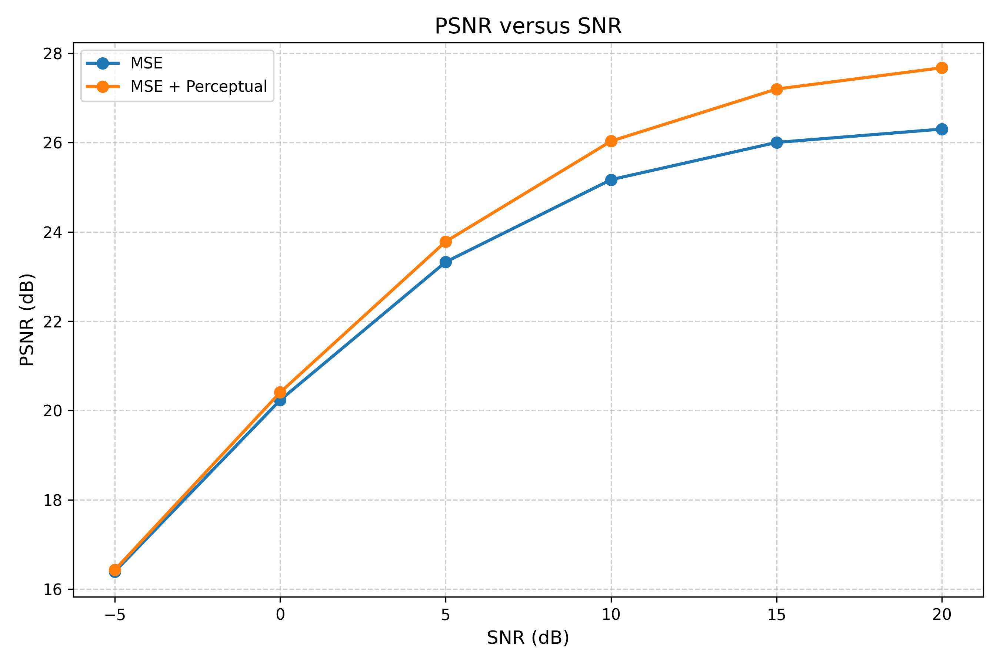

### 3.6.2. Analyse du SSIM

Les résultats du SSIM montrent également une amélioration en faveur du modèle intégrant la perte perceptuelle.

À 20 dB, le SSIM atteint environ 0,909 pour le modèle perceptuel, contre 0,870 pour le modèle MSE.

Cela suggère une meilleure préservation des structures visuelles des images reconstruites.

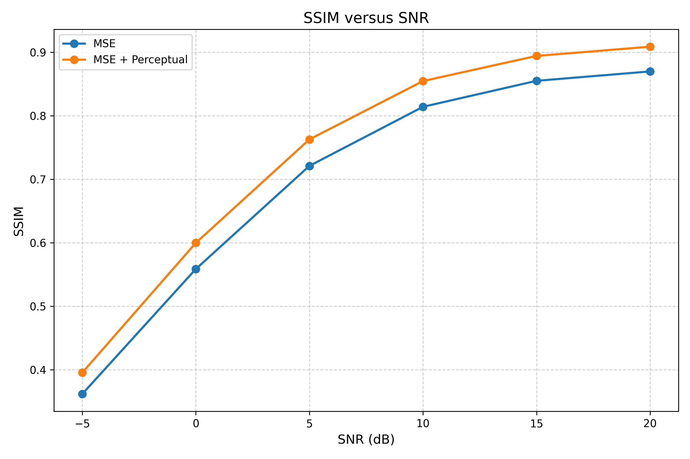

### 3.6.3. Analyse de la Perceptual Loss

La Perceptual Loss diminue lorsque le SNR augmente pour les deux modèles.

Le modèle entraîné avec la combinaison MSE + Perceptual Loss obtient des valeurs plus faibles sur l'ensemble des conditions évaluées.

À 20 dB, cette valeur est de 0,377 pour le modèle perceptuel, contre 0,513 pour le modèle MSE.

Cette observation confirme que l'ajout de la perte perceptuelle pendant l'entraînement améliore la similarité des caractéristiques extraites par VGG16.

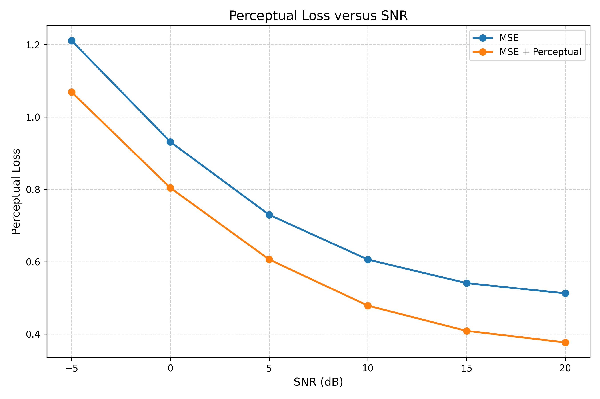

### 3.6.4. Comparaison globale

Les résultats expérimentaux montrent que l'intégration d'une perte perceptuelle améliore les trois métriques considérées dans cette expérience.

L'amélioration est particulièrement visible lorsque les conditions de transmission sont moins bruitées.

Ces observations mettent en évidence l'intérêt de combiner une perte pixel par pixel et une perte basée sur les caractéristiques visuelles pour entraîner un système de communication sémantique.
Les reconstructions comparées aux images originales pour plusieurs valeurs de SNR sont générées par `src/evaluation/visualize_reconstructions.py` :

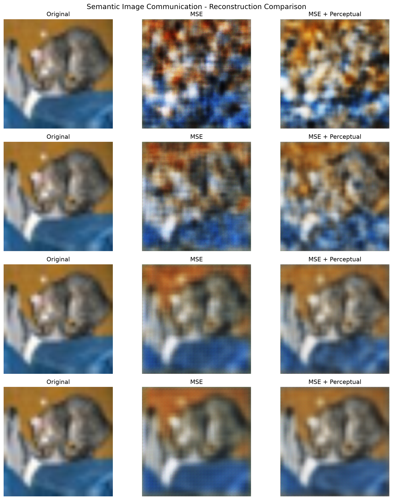

## 3.7. Conclusion

Dans cette partie, nous avons conçu et évalué un système de communication sémantique d'images reposant sur une architecture CNN encodeur-décodeur et un canal AWGN.

Deux stratégies d'entraînement ont été étudiées : une première basée uniquement sur la MSE et une deuxième combinant la MSE avec une perte perceptuelle extraite d'un réseau VGG16 pré-entraîné.

Les résultats obtenus montrent que la deuxième stratégie fournit de meilleures performances selon les métriques PSNR, SSIM et Perceptual Loss pour les conditions de SNR étudiées.

Cette expérimentation constitue une première validation du système proposé. Des entraînements supplémentaires et des évaluations sur des jeux de données plus diversifiés permettraient de renforcer la généralisation et la robustesse des résultats.
